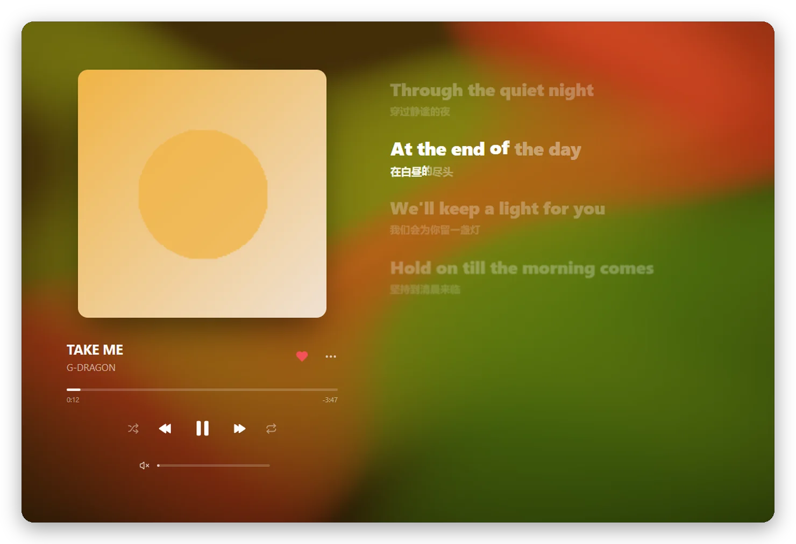

<div align="center">


# Sonora v1.0 · Custom Windows Fork

**Flow & Liquid Glass · Word-timed bilingual stage · Draggable multi-monitor island · Local music · Sticky playlist search**

An independent fork of MySpotify with its own identity, custom icon, and isolated profile directories—focused on fluid desktop lyrics, multi-monitor dynamic island, local playback, and effortless search in large playlists.

[简体中文](README.md) · **English**

[](https://github.com/hfx123456/Sonora/releases/latest)

[](LICENSE)

**[Download Sonora](https://github.com/hfx123456/Sonora/releases/latest)** · [Lyrics guide (Chinese)](FUSION.md) · [Changelog](CHANGELOG.md) · [Upstream](https://github.com/margbug01/MySpotify)


</div>

Maintained by **hfx123456**, based on [margbug01/MySpotify](https://github.com/margbug01/MySpotify). Below are the key additions and refinements in **Sonora v1.0**; Spotify browsing, streaming, music videos, and podcasts come from upstream. Publishes **Windows 10/11 x64** builds.

---

## 1. Flow Backdrop, Liquid Glass & Word-Timed Bilingual Stage

- **Apple Music-style GPU Flow Backdrop**: Real-time animated mesh gradient derived from the current album artwork, drifting and breathing with playback.
- **iOS-style Liquid Glass**: Unified translucent glass surfaces for the Now Playing mode switcher, stage controls, and floating bars, with a toggle and continuous strength slider in Settings.
- **Word-Timed Bilingual Stage**: Both original lyrics and Chinese translations spring in, unblur, glow in the album accent color, and drift word-by-word along the playback timeline; top tabs and transport controls appear on pointer hover and fade away cleanly when idle.
- **Scrolling Lyrics Sweep**: Continuous karaoke sweep, subtle lift, and glow on the active line and its translation, while pausing stops continuous repaints.

<table>
  <tr>
    <td width="50%"><br><b>Stage Mode</b>: Flow backdrop, Liquid Glass controls, and word-timed bilingual motion.</td>
    <td width="50%"><br><b>Lyrics Mode</b>: Continuous word sweep for both original text and translation.</td>
  </tr>
</table>

---

## 2. Draggable Multi-Monitor Island & Quick Unlock

The **Fusion 双语歌词** menu at the right of the player bar provides three overlay modes:

| Mode | Behavior |
| --- | --- |
| **Dynamic Island** | Anchored to the physical top edge of its display by default with spring-animated width and height. **Drag it freely anywhere, including across multiple monitors**: dragging away from the top edge smoothly turns it into a rounded floating capsule, and dragging back to any monitor's top edge snaps it flush to that display. Multi-monitor setups also get a **Move Island to Next Display** menu action. |
| **Transparent Desktop Lyrics** | Outlined two-line lyrics floating over your windows. Hovering when unlocked reveals a dark translucent bar with track info and playback/lock controls. |
| **In-App Bilingual Panel** | Full scrollable bilingual lyrics with click-to-seek and animated artwork backdrop. |

### Click-Through Lock with Instant Unlock Pill

- When locked for click-through, moving the mouse over or clicking the lyrics/island reveals a compact **Unlock (解锁)** pill without any distracting dark box around the lyrics; only that small pill accepts clicks while the rest of the lyrics remain click-through.
- Floating overlays automatically hide when paused and return on resume.

<table>
  <tr>
    <td width="50%"><br><b>Floating Island</b>: Dragged away from the top edge or onto another monitor.</td>
    <td width="50%"><br><b>Quick Unlock Pill</b>: Appears on hover/click while keeping lyrics click-through.</td>
  </tr>
  <tr>
    <td width="50%"><br><b>Top-Edge Island</b>: Attached cleanly to the display's physical top.</td>
    <td width="50%"><br><b>Desktop Lyrics</b>: Crisp outlined text over any window.</td>
  </tr>
</table>

---

## 3. Embedded Bilingual Lookup, Playlist Search & Local Music

- **Embedded Lyricify Lyrics Helper**: Searches **NetEase Cloud Music, QQ Music, and LRCLIB** with cross-script alias matching, QRC/YRC/LRC/TTML/LYS/LYL import, ±0.5s global timing offset, and bundled .NET runtime (no separate installation required).
- **Sticky Playlist & Local Search**: Capsule search bar sticks to the top while scrolling, supports Simplified/Traditional Chinese matching, space-separated multi-term filtering, consistent playlist sorting, and preserves the full queue when playing a filtered track.
- **Local Music**: Recursive folder or single-file scanning (`MP3 / FLAC / M4A / WAV / OGG / Opus / AAC`) with embedded tags, artwork, and `.lrc` support without requiring Spotify sign-in.


---

## Install, Isolation & Build

1. Download the release archive from **[Sonora Releases](https://github.com/hfx123456/Sonora/releases/latest)**, extract all files alongside `Sonora.exe`, and run `Sonora.exe` (requires Microsoft Edge WebView2 Runtime on Windows 10/11).
2. **Isolated from upstream MySpotify**: Uses its own single-instance lock, icon, identifier (`dev.hfx123456.sonora`), and directories (`%APPDATA%\Sonora` / `%LOCALAPPDATA%\Sonora`), migrating existing settings on first launch without altering the legacy folder.

```powershell
$env:CGO_ENABLED = '0'
go test ./internal/...
go build -trimpath -ldflags='-H windowsgui -s -w' -o Sonora.exe .
```

Retained under **AGPL-3.0** based on [margbug01/MySpotify](https://github.com/margbug01/MySpotify). See [DEVELOPMENT.md](DEVELOPMENT.md), [FUSION.md](FUSION.md), and [CHANGELOG.md](CHANGELOG.md).
