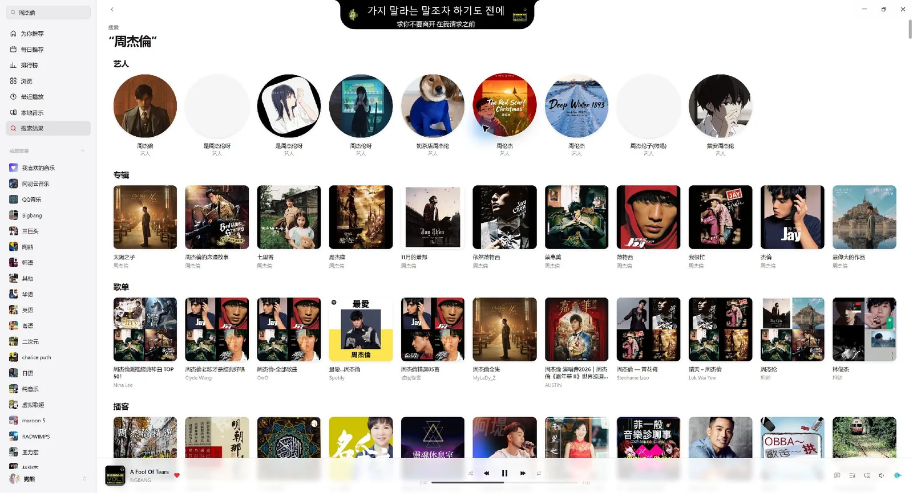

# Sonora · Custom Windows Fork

**Lyric island · Bilingual word highlighting · Local music · Sticky playlist search**

An independent fork of MySpotify with its own identity, custom icon and isolated profile directories, focused on desktop lyrics, local listening and finding songs in large playlists.

[简体中文](README.md) · **English**

**[Download this fork](https://github.com/hfx123456/MySpotify/releases/latest)** · [Lyrics guide (Chinese)](FUSION.md) · [Changelog](CHANGELOG.md) · [Upstream](https://github.com/margbug01/MySpotify)

Maintained by **hfx123456**, based on [margbug01/MySpotify](https://github.com/margbug01/MySpotify). This page describes the additions in this fork. Spotify browsing, streaming, music videos and podcasts come from upstream. This fork currently publishes **Windows 10/11 x64** builds.

## Desktop lyrics that fit around your windows

The **Fusion 双语歌词** button at the far right of the player bar offers three views:

| View | Behavior |
| --- | --- |
| **Top-edge lyric island** | A capsule attached to the physical screen edge, with lyrics, Chinese translation and cover art; can also become a draggable floating capsule. |
| **Transparent desktop lyrics** | Outlined original text above its Chinese translation, draggable over other windows. |
| **In-app bilingual panel** | Scrollable lyrics with click-to-seek and an animated background based on cover colors. |

- Floating lyrics **hide on pause and return on resume**.
- The attached island can fade out and allow clicks through when the pointer enters, then reappear when it leaves. Avoidance is optional.
- Overlays can be locked for click-through; unlock them from the player menu or tray.
- Choose a lyrics font and a separate Chinese font. Adjust font size and island width independently; positions and preferences are saved.
- Chinese songs use one line. A translation line appears only when a valid Chinese translation exists.
- The intro title/credits stage now refreshes at 30 FPS in motion mode, fixing its animation stutter.

<table>
  <tr>
    <td width="50%"> <b>Lyric island</b></td>
    <td width="50%"> <b>Transparent desktop lyrics</b></td>
  </tr>
</table>

## Bilingual lookup, timing and animation

The embedded **Lyricify Lyrics Helper** searches **NetEase Cloud Music, QQ Music and LRCLIB** for both online and local songs. Candidates are checked against title, artist, album and duration, preferring synchronized lyrics before comparing translations and word timing.

- Word highlighting, lift, subtle scale and glow, including transitions for translated lines; motion can be disabled.
- Real word timestamps are used when available. With line timing only, word highlighting is an approximate visual effect, not syllable alignment.
- Import `LRC / TTML / YRC / QRC / LYS / LYL`, or force a new lookup bypassing cached results.
- Adjust the overlay's global timing offset in 0.5-second steps from its menu.
- Local sidecar LRC or embedded lyrics containing Chinese are preferred. Manual imports last for the current track session.
- The release includes the lyrics helper and its .NET runtime. No separate .NET or Lyricify Fusion installation is needed.

Translations come from lyric providers; there is no machine translation service and coverage is not guaranteed. Lookup sends track metadata, not local audio. See [FUSION.md](FUSION.md) for details.

Actual lyrics menu

## Sticky search inside playlists

The new playlist search box starts below the playlist header and sticks to the content's top edge as you scroll.

- Filter instantly by **title, artist or album**, see the result count and clear the query in one click.
- Match **simplified and traditional Chinese** in either direction without changing displayed metadata.
- Space-separated terms must all match; terms can span metadata fields. English matching ignores case.
- Typing a space in the search box does not pause playback.
- Double-click a result to play from its original playlist position, keeping the **full playlist queue**.
- Each playlist retains its own query during the current app session.

Chinese variant matching here applies to **local filtering within a playlist**; it is not a claim about Spotify's global search.

## Play music already on your computer

The new **本地音乐** sidebar page imports folders recursively or individual files and plays them from their original locations without Spotify sign-in.

- Scans `MP3 / FLAC / M4A / WAV / OGG / Opus / AAC`; decoding depends on the playback component's support for the file encoding.
- Reads tags, embedded artwork and lyrics, plus same-name `.lrc` files; filter by title, artist or album.
- Uses the same queue, shuffle, repeat, seeking, volume and desktop lyrics. Online lyrics lookup still requires a connection.
- Matches `spotify:local:` playlist entries uniquely to imported files by title, artist and album; missing or ambiguous matches remain unplayable.
- Removing a source does not delete files. Rescan after changes; download OneDrive cloud files before playing them.

Local music does not transfer through Spotify Connect, and protected Apple Music `.m4p` files are unsupported.

## Install and update

1. Download `Sonora-<version>-windows-amd64.zip` or `sonora-<version>-windows-amd64.tar.gz` from **[this repository's Releases](https://github.com/hfx123456/MySpotify/releases/latest)**.
2. Extract the complete archive, retain the accompanying license files and resources alongside `Sonora.exe`, and run `Sonora.exe`.
3. Online Spotify sign-in and playback need [Microsoft Edge WebView2 Runtime](https://developer.microsoft.com/microsoft-edge/webview2/).
4. Use **本地音乐** to add local songs, or **Fusion 双语歌词** in the player bar to enable an overlay.

Signed builds use **hfx123456/MySpotify** as their update source and verify updates using this fork's public key. Check for updates under **设置 → 关于**.

**Sonora is isolated from upstream MySpotify**: it uses its own single-instance lock, icon, identifier (`dev.hfx123456.sonora`), and profile directories (`%APPDATA%\Sonora` / `%LOCALAPPDATA%\Sonora`), so both apps can coexist side by side. On first launch it automatically migrates existing settings, playback state, caches and sealed login cookies from `Vinyl` without modifying the legacy folder.

## Inherited features and limits

Spotify browsing, streaming, music videos, podcasts, scrolling lyrics, media keys, global shortcuts, tray behavior and themes are inherited from upstream, not new additions by this fork.

Sonora is an unofficial personal project, unaffiliated with Spotify. Online features use Spotify's internal web-player interfaces and may break or conflict with its terms, putting accounts at risk. DRM decryption remains in the system web component; cached encrypted segments are not offline audio downloads. Use only your own account.

Windows settings, playback state and logs live under `%APPDATA%\Sonora`; login data and caches use relevant subdirectories under `%LOCALAPPDATA%\Sonora`. Keep login data out of public repositories.

## Development and attribution

See [DEVELOPMENT.md](DEVELOPMENT.md) for development, [FUSION.md](FUSION.md) for the custom lyrics component, and [CHANGELOG.md](CHANGELOG.md) for changes. The dated [source-package notes](README-未编译源码.md) describe the source handoff at that time.

- **Upstream application**: [margbug01/MySpotify](https://github.com/margbug01/MySpotify), retained under **AGPL-3.0**.
- **Native UI**: [MyGo](https://github.com/egoist/mygo); upstream's interface originated in [mygo-cloudmusic](https://github.com/egoist/mygo-cloudmusic).
- **Lyrics lookup and parsing**: [Lyricify Lyrics Helper](https://github.com/WXRIW/Lyricify-Lyrics-Helper), Apache-2.0.
- **Adapted backgrounds**: [Lyricify Backgrounds](https://github.com/WXRIW/Lyricify-Backgrounds), Apache-2.0. Island appearance and concept credit Lyricify; see the third-party notices for visual attribution.

The lyric windows are drawn by this application; no unpublished complete Lyricify Fusion UI source is used. Full component versions, licenses and notices are listed in [THIRD-PARTY-NOTICES.md](THIRD-PARTY-NOTICES.md) and [licenses/](licenses/). Retain these and [LICENSE](LICENSE) when redistributing. Spotify trademarks and screenshot artwork belong to their respective owners.
