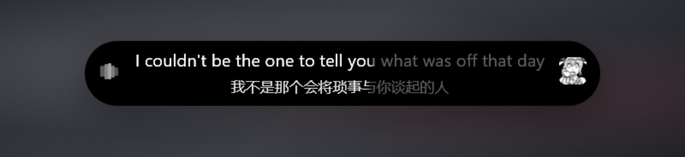
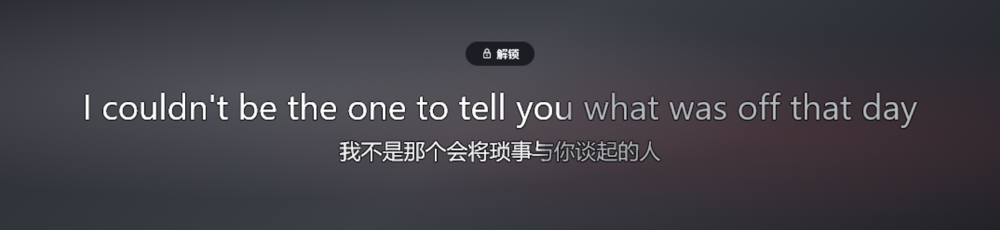
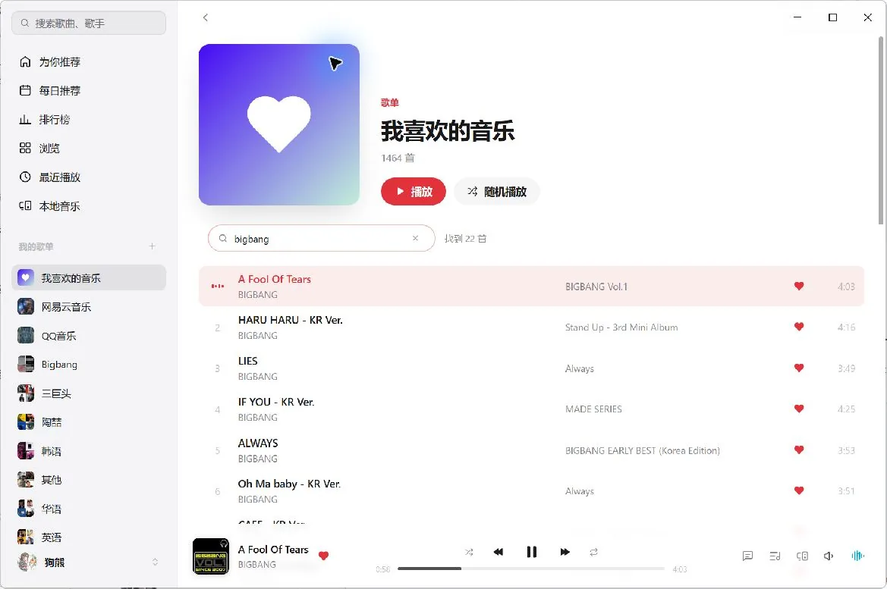
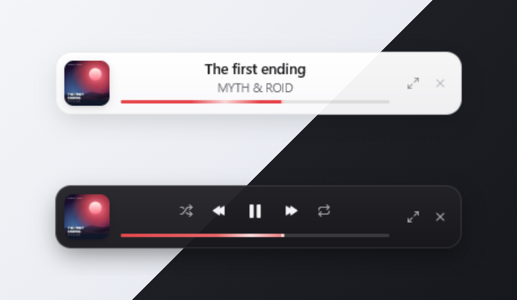
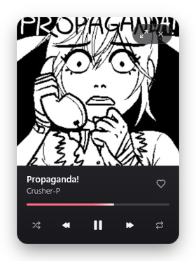
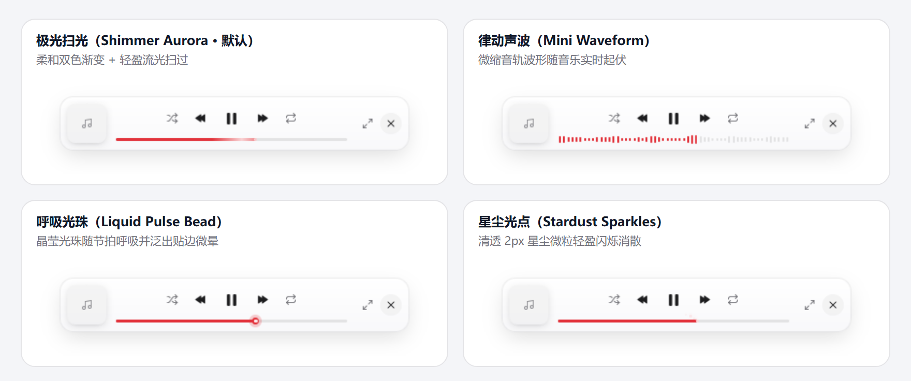
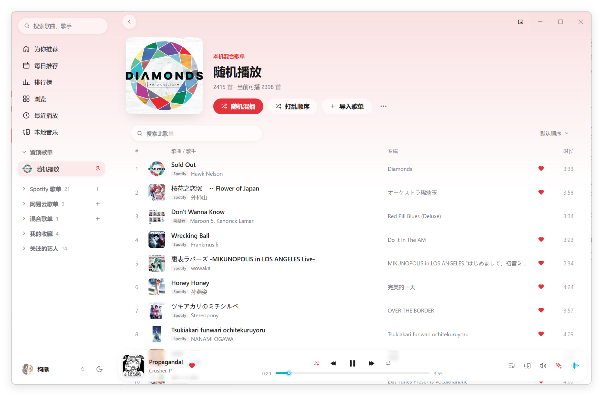
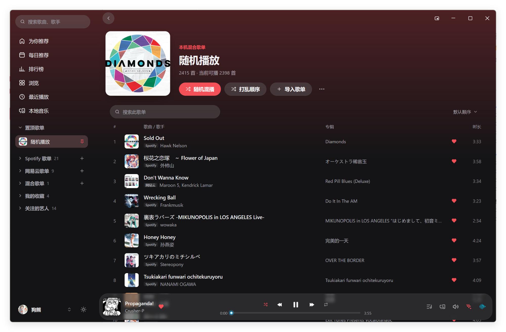
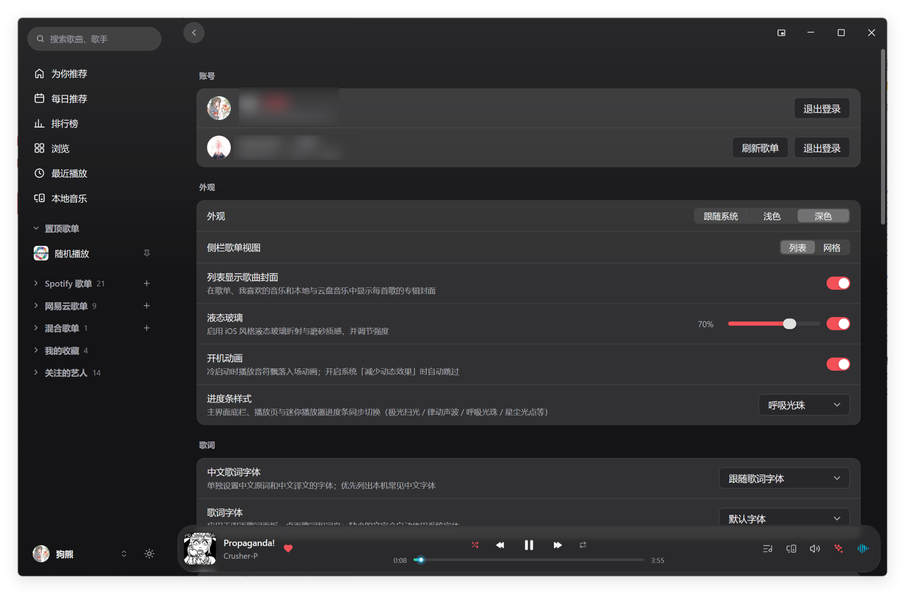

# Sonora

English | **[简体中文](README.md)**

<p align="center">
  
</p>

<p align="center">
  Native multi-source desktop music player built with <b>Go + MyGo</b> (based on <a href="https://github.com/margbug01/MySpotify">MySpotify</a>)<br>
  <b>Spotify + Direct NetEase Playlists + 6 Cloud Drives + Multi-Source Hybrid Playlists · Smart Cross-Source Dedup · Word-by-Word Bilingual Lyrics · Dynamic Island · Apple Music Mini Player · Windows &amp; macOS</b>
</p>

<p align="center">
  <a href="https://github.com/hfx123456/Sonora/releases/latest"></a>
  
  
  <a href="https://awesomemygo.dev/apps/sonora"></a>
</p>

<p align="center">
  
</p>

---

## 1. Personal Cloud Music Disk & Local Library

Store your personal audio library in your own cloud drive and stream seamlessly across devices—without copying gigabytes of files:

- **6 Cloud Providers Built In**: Native support for **OneDrive / Microsoft 365**, **Google Drive**, **Baidu Netdisk**, **Quark Drive**, **115 Drive**, and **WebDAV** (with quick presets for Alist, Jianguoyun, 123Pan, and NAS).
- **Sign In First, Pick Folder Visually**: Built-in QR login window for Quark & 115; after sign-in, a visual folder browser lets you single-click to select a folder and double-click to drill into subfolders—scanning only the folder you pick.
- **Fast Scan + Auto-Cache on Play**: OneDrive uses `/delta` flat scanning with instant startup cache; playing a cloud track caches it locally and extracts embedded album art & tags automatically, plus a one-click **Cache All Locally** button.
- **Cross-Device `spotify:local:` Matching & Upload**: Cloud tracks automatically light up matching `spotify:local:` entries in your Spotify playlists across devices; right-click local tracks to upload to cloud, or hide unwanted non-song audio files (automatically cleaning up local cache without touching original files).
- **Privacy First**: All passwords, cookies, and OAuth refresh tokens are encrypted locally via the OS keystore (Windows DPAPI / macOS Keychain).

<table>
  <tr>
    <td width="50%"><br><b>6 Cloud Providers &amp; Visual Folder Picker</b>: Sign in first, single-click to select, double-click to browse.</td>
    <td width="50%"><br><b>Full Embedded Artwork &amp; Local Caching</b>: Instant playback and embedded cover extraction once cached.</td>
  </tr>
</table>

---

## 2. Flow Backdrop, Liquid Glass & Word-by-Word Bilingual Lyrics

- **Flow Backdrop**: GPU fluid mesh gradient driven by the current cover palette, smoothly crossfading on track changes and settling when paused.
- **Liquid Glass**: iOS-style frosted refraction across bars and floating controls with adjustable strength.
- **Stage & Scrolling Bilingual Motion**: Translated words animate in lockstep with the original vocals; mid-song interludes gently keep the last sung line visible above breathing countdown dots.

<table>
  <tr>
    <td width="50%"><br><b>Stage Bilingual Motion</b>: Synchronized word-by-word animation for original and translated lines.</td>
    <td width="50%"><br><b>Now Playing Lyrics</b>: Continuous sweep highlighting over Flow backdrop and Liquid Glass chrome.</td>
  </tr>
</table>

---

## 3. Draggable Multi-Monitor Dynamic Island & Click-Through Desktop Lyrics

- **Multi-Monitor Dynamic Island**: Drag freely away from the top bezel or onto another monitor—automatically morphing between a top-attached notch and a rounded floating capsule, with a menu shortcut to move to the next display.
- **Instant Unlock Pill**: While locked (click-through), hovering or clicking reveals a compact **Unlock** pill without adding any dark background box.
- **Pure-Go Multi-Source Bilingual Lookup**: Native zero-`.NET` lyrics engine aggregating **NetEase Cloud Music, QQ Music (local QRC decryption), and LRCLIB** with YRC / QRC / TTML (including inline translations) / LRC parsing, cross-script alias matching, and ±0.5s timing offset.

<table>
  <tr>
    <td width="50%"><br><b>Floating Island</b>: Dragged away from the top edge or onto another monitor.</td>
    <td width="50%"><br><b>Quick Unlock Pill</b>: Appears on hover/click while keeping lyrics click-through.</td>
  </tr>
  <tr>
    <td width="50%"><br><b>Top-Edge Island</b>: Attached cleanly to the display's physical top with live spectrum bars.</td>
    <td width="50%"><br><b>Desktop Lyrics</b>: Crisp outlined bilingual subtitles over any window.</td>
  </tr>
</table>

---

## 4. Unified Track Covers Toggle & Sticky Capsule Search

- **Unified Album Thumbnails**: Playlists, Liked Songs, Recently Played, Daily Mix, Artist Top Tracks, and Local/Cloud Music all display consistent per-row album thumbnails—toggleable anytime in **Settings → Appearance → Show Track Covers in Lists**.
- **Sticky Capsule Search**: Sticks cleanly to the top while scrolling, with Simplified/Traditional Chinese matching, multi-term filtering, consistent sorting, and full-queue playback preservation.

<table>
  <tr>
    <td width="50%"><br><b>Unified Track Covers (Toggleable)</b>: Consistent per-row album thumbnails across all lists.</td>
    <td width="50%"><br><b>Sticky Capsule Search</b>: Fast multi-term filtering while preserving the full playback queue.</td>
  </tr>
</table>

---

## 5. Apple Music-Style Mini Player, 6 Synced Progress Effects & Launch Animation

- **One-Click Main Window ↔ Mini Mode**: Click the native-styled **Switch to Mini Mode** button in the top-right title bar (aligned seamlessly beside minimize/maximize/close on Windows, and in Now Playing) to hide the main window and enter the floating Mini Player; click `⤢` (or the cover) to jump straight back to the main window. Right-click or use Settings to switch between **Compact Bar** (`360 × 56`, strictly concentric `16px` corners and inset soft specular rim, minimal centered title & animated progress at rest, crossfading in-place to full transport controls on hover) and **Seamless Gradient-Melt Cover Card** (`232 × 324`, full-bleed rounded artwork smoothly feathered via Oklab gradient into the control deck with zero hard seam, draggable anywhere, plus Like heart and transport). Automatically syncs with the app's Light/Dark appearance and remembers its desktop position.
- **6 Synchronized Progress Bar Effects**: Click the ✨ **Progress Style** button in the bottom player bar, right-click the progress bar or Mini Player, or open **Settings → Appearance → Progress Style** to switch live across the **main player bar, Now Playing, Stage, and Mini Player** (with vibrant fallback palettes so monochrome covers never turn muddy grey):
  - **Shimmer Aurora** (default): Smooth dual-tone gradient rail with a soft drifting light sweep;
  - **Mini Waveform**: Micro equalizer waveform bars whose playhead bars bounce live with the music;
  - **Liquid Pulse Bead**: Dual-tone rail with a luminous breathing crystal bead hugging the playhead;
  - **Stardust Sparkles**: Crisp 2px sparkling stardust particles drifting cleanly above the playhead;
  - Plus **Comet Smoke** and **Classic Minimal**.
- **Borderless Falling-Notes Launch Animation**: Cold launches float vector musical notes directly over the desktop before assembling the borderless Sonora emblem and smoothly fading in the main window (toggleable in **Settings → Appearance → Startup Animation**, and automatically skipped when system Reduce Motion is enabled).

<table>
  <tr>
    <td width="58%" align="center"><br><b>Apple Music Compact Bar (Light / Dark)</b>: Minimal at rest, in-place controls on hover, auto-synced with app appearance.</td>
    <td width="42%" align="center"><br><b>Gradient-Melt Cover Card (Dark Mode)</b>: Full-bleed draggable rounded artwork smoothly melting into the control deck below.</td>
  </tr>
  <tr>
    <td colspan="2" align="center"><br><b>4 New Synced Progress Bar Effects (Native Go Renders)</b>: Shimmer Aurora · Mini Waveform · Liquid Pulse Bead · Stardust Sparkles.</td>
  </tr>
</table>

---

## 6. Direct NetEase Playlists, Multi-Source Hybrid Playlists & Smart Deduplication

Bring **Spotify, NetEase Cloud Music, local lossless files, and 6 cloud drives** together into one unified library—usable even without a Spotify account:

- **Dedicated NetEase Playlists Section & Dual-Account Settings**:
  - Clean collapsible sidebar sections: **Pinned Playlists → Spotify Playlists → NetEase Playlists → Hybrid Playlists → Saved**, all supporting list/grid views and pinning.
  - Manage **Spotify (Primary)** and **NetEase Cloud Music (Secondary)** side by side in **Settings → Account** with unified circular avatars, badges, playlist sync count, and OS-keystore encrypted cookies.
  - Paste any public NetEase playlist link, `163cn.tv` short URL, or numeric ID to add it directly without signing in (automatically fetching full track lists past 1,000+ songs).
- **NetEase-First Playback with Automatic Local & Spotify Fallback**:
  - NetEase tracks stream directly via NetEase's playback API by default (up to 320 kbps with your optional cookie) and fetch exact synced/bilingual lyrics by NetEase song ID.
  - When a NetEase track is unavailable or restricted to a 30-second trial preview, Sonora seamlessly falls back to your local/cloud library or Spotify full version and caches the mapping. Hovering the bottom player cover reveals a **Source** row inside the Credits popover showing the active playback source (e.g., `Spotify`, `NetEase`, `NetEase (Switched to Spotify)`, `Local`, or cloud drive name).
- **4-Source Hybrid Playlists & Priority Deduplication (`Spotify > Local/Cloud > NetEase`)**:
  - Import whole Spotify, NetEase, local, or cloud playlists into local Hybrid Playlists with one-click order shuffling and shuffled playback by default.
  - Cross-source duplicate detection (Simplified/Traditional Chinese normalization, title folding, and sorted artist matching) automatically skips duplicates during both playlist import and shuffled playback, always keeping the highest-priority source (**Spotify > Local/Cloud > NetEase**).
- **Per-Track Lyrics Timing Offset**:
  - Fine-tune lyrics timing in `±0.2s` steps (with one-click reset) persisted independently per `(track, lyrics source)` across desktop lyrics, Dynamic Island, side panel, Now Playing, and Stage.

<table>
  <tr>
    <td width="50%"><br><b>Multi-Source Hybrid Playlist (Light Mode)</b>: Mix Spotify, NetEase, local, and cloud tracks with smart dedup and shuffled playback.</td>
    <td width="50%"><br><b>Multi-Source Hybrid Playlist (Dark Mode)</b>: Adaptive dark cover wash, Liquid Glass bar, and crisp source badges.</td>
  </tr>
  <tr>
    <td width="50%"><br><b>Unified Dual-Account Settings (Light Mode)</b>: Manage Spotify (Primary) and NetEase (Secondary) side by side with one-click playlist sync.</td>
    <td width="50%"><br><b>Unified Dual-Account Settings (Dark Mode)</b>: Matching dark-mode account cards, Liquid Glass, and progress bar settings.</td>
  </tr>
  <tr>
    <td colspan="2" align="center"><br><b>Sonora v1.1.0 Home Overview</b>: Pinned playlists, separated Spotify / NetEase / Hybrid sections, Liquid Glass, and animated progress bar.</td>
  </tr>
</table>

---

## Install, Isolation & Build

1. Download from **[Sonora Releases](https://github.com/hfx123456/Sonora/releases/latest)**:
   - **Windows**: Run `sonora-setup-1.1.0-amd64.exe` for one-click install (handles shortcuts & WebView2), or extract `Sonora-1.1.0-windows-amd64.zip`.
   - **macOS**: Download `sonora-1.1.0.dmg` (Apple Silicon & Intel) and drag Sonora to Applications (for the first launch of an unnotarized build, right-click → Open or allow it in Privacy & Security).
   Pure Go native binary (~20 MB) with built-in multi-source lyrics—no `.NET` runtime or extra setup needed.
2. **Isolated from upstream MySpotify**: Uses its own single-instance lock, icon, identifier (`dev.hfx123456.sonora`), and directories (`%APPDATA%\Sonora` / `%LOCALAPPDATA%\Sonora`), migrating existing settings on first launch without altering the legacy folder.

```powershell
$env:CGO_ENABLED = '0'
go test ./internal/...
go build -trimpath -ldflags='-H windowsgui -s -w' -o Sonora.exe .
```

## Acknowledgments & License

- **[margbug01/MySpotify](https://github.com/margbug01/MySpotify)** (**AGPL-3.0**): Upstream base providing Spotify browsing, playback, MV, podcasts, media keys, tray, and core architecture; retained under **AGPL-3.0**.
- **[egoist/mygo](https://github.com/egoist/mygo)** (**MIT**): Native cross-platform UI toolkit, spring animations, Liquid Glass material, and GPU shader pipeline.
- **[WXRIW / Lyricify](https://github.com/WXRIW/Lyricify-App)**:
  - **[Lyricify Lyrics Helper](https://github.com/WXRIW/Lyricify-Lyrics-Helper)** (**Apache-2.0**): Multi-source bilingual lyrics search & QRC decryption (NetEase, QQ Music, LRCLIB).
  - **[Lyricify Backgrounds](https://github.com/WXRIW/Lyricify-Backgrounds)** (**Apache-2.0**): Dynamic backdrop shader adaptation inspired by iOS Classic backgrounds.
  - **Dynamic Lyrics Island concept** (**CC BY-SA 4.0**): Top lyrics island and desktop lyrics appearance credited to Lyricify.
- Full third-party notices and license texts are in [THIRD-PARTY-NOTICES.md](THIRD-PARTY-NOTICES.md) and `licenses/`. See also [DEVELOPMENT.md](DEVELOPMENT.md), [FUSION.md](FUSION.md), and [CHANGELOG.md](CHANGELOG.md).
