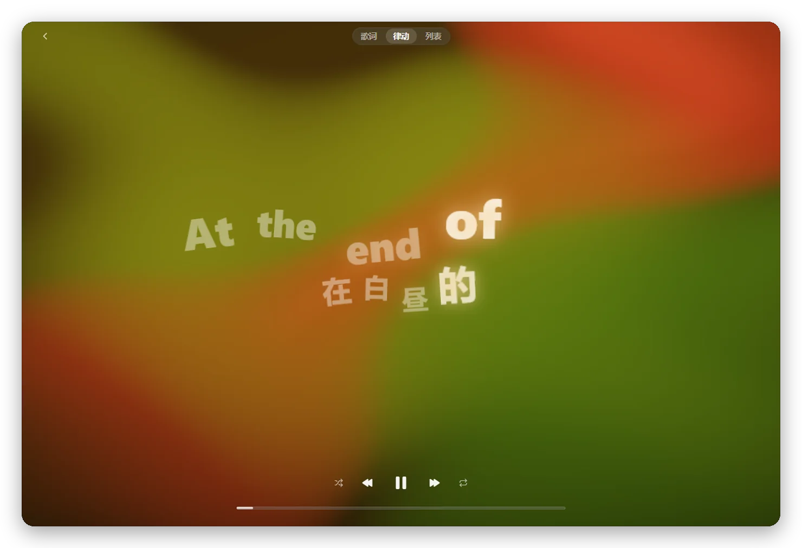
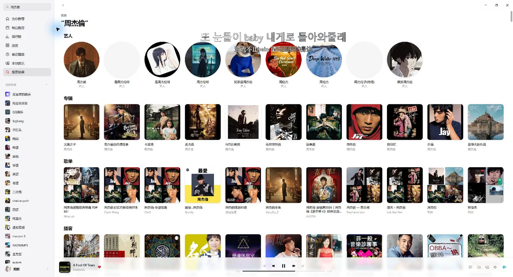

# Sonora

English | **[简体中文](README.md)**

<p align="center">
  
</p>

<p align="center">
  Native Spotify desktop client &amp; personal Cloud Music Disk built with <b>Go + MyGo</b> (based on <a href="https://github.com/margbug01/MySpotify">MySpotify</a>)<br>
  <b>6 Cloud Drives · Word-by-Word Bilingual Lyrics · Draggable Dynamic Island · Liquid Glass &amp; Flow Backdrop · Windows &amp; macOS</b>
</p>

<p align="center">
  <a href="https://github.com/hfx123456/Sonora/releases/latest"></a>
  
  
  <a href="https://awesomemygo.dev/apps/sonora"></a>
</p>

<p align="center">
  
</p>

---

## 1. Personal Cloud Music Disk & Local Library

Store your personal audio library in your own cloud drive and stream seamlessly across devices—without copying gigabytes of files:

- **6 Cloud Providers Built In**: Native support for **OneDrive / Microsoft 365**, **Google Drive**, **Baidu Netdisk**, **Quark Drive**, **115 Drive**, and **WebDAV** (with quick presets for Alist, Jianguoyun, 123Pan, and NAS).
- **Sign In First, Pick Folder Visually**: Built-in QR login window for Quark & 115; after sign-in, a visual folder browser lets you single-click to select a folder and double-click to drill into subfolders—scanning only the folder you pick.
- **Fast Scan + Auto-Cache on Play**: OneDrive uses `/delta` flat scanning with instant startup cache; playing a cloud track caches it locally and extracts embedded album art & tags automatically, plus a one-click **Cache All Locally** button.
- **Cross-Device `spotify:local:` Matching & Upload**: Cloud tracks automatically light up matching `spotify:local:` entries in your Spotify playlists across devices; right-click local tracks to upload to cloud, or hide unwanted non-song audio files (automatically cleaning up local cache without touching original files).
- **Privacy First**: All passwords, cookies, and OAuth refresh tokens are encrypted locally via the OS keystore (Windows DPAPI / macOS Keychain).

<table>
  <tr>
    <td width="50%"><br><b>6 Cloud Providers &amp; Visual Folder Picker</b>: Sign in first, single-click to select, double-click to browse.</td>
    <td width="50%"><br><b>Full Embedded Artwork &amp; Local Caching</b>: Instant playback and embedded cover extraction once cached.</td>
  </tr>
</table>

---

## 2. Flow Backdrop, Liquid Glass & Word-by-Word Bilingual Lyrics

- **Flow Backdrop**: GPU fluid mesh gradient driven by the current cover palette, smoothly crossfading on track changes and settling when paused.
- **Liquid Glass**: iOS-style frosted refraction across bars and floating controls with adjustable strength.
- **Stage & Scrolling Bilingual Motion**: Translated words animate in lockstep with the original vocals; mid-song interludes gently keep the last sung line visible above breathing countdown dots.

<table>
  <tr>
    <td width="50%"><br><b>Stage Bilingual Motion</b>: Synchronized word-by-word animation for original and translated lines.</td>
    <td width="50%"><br><b>Now Playing Lyrics</b>: Continuous sweep highlighting over Flow backdrop and Liquid Glass chrome.</td>
  </tr>
</table>

---

## 3. Draggable Multi-Monitor Dynamic Island & Click-Through Desktop Lyrics

- **Multi-Monitor Dynamic Island**: Drag freely away from the top bezel or onto another monitor—automatically morphing between a top-attached notch and a rounded floating capsule, with a menu shortcut to move to the next display.
- **Instant Unlock Pill**: While locked (click-through), hovering or clicking reveals a compact **Unlock** pill without adding any dark background box.
- **Embedded Bilingual Lookup**: Bundled Lyricify Lyrics Helper + .NET runtime aggregating **NetEase Cloud Music, QQ Music (local QRC decryption), and LRCLIB** with cross-script alias matching and ±0.5s timing offset.

<table>
  <tr>
    <td width="50%"><br><b>Floating Island</b>: Dragged away from the top edge or onto another monitor.</td>
    <td width="50%"><br><b>Quick Unlock Pill</b>: Appears on hover/click while keeping lyrics click-through.</td>
  </tr>
  <tr>
    <td width="50%"><br><b>Top-Edge Island</b>: Attached cleanly to the display's physical top with live spectrum bars.</td>
    <td width="50%"><br><b>Desktop Lyrics</b>: Crisp outlined bilingual subtitles over any window.</td>
  </tr>
</table>

---

## 4. Unified Track Covers Toggle & Sticky Capsule Search

- **Unified Album Thumbnails**: Playlists, Liked Songs, Recently Played, Daily Mix, Artist Top Tracks, and Local/Cloud Music all display consistent per-row album thumbnails—toggleable anytime in **Settings → Appearance → Show Track Covers in Lists**.
- **Sticky Capsule Search**: Sticks cleanly to the top while scrolling, with Simplified/Traditional Chinese matching, multi-term filtering, consistent sorting, and full-queue playback preservation.

<table>
  <tr>
    <td width="50%"><br><b>Unified Track Covers (Toggleable)</b>: Consistent per-row album thumbnails across all lists.</td>
    <td width="50%"><br><b>Sticky Capsule Search</b>: Fast multi-term filtering while preserving the full playback queue.</td>
  </tr>
</table>

---

## Install, Isolation & Build

1. Download from **[Sonora Releases](https://github.com/hfx123456/Sonora/releases/latest)**:
   - **Windows**: Run `sonora-setup-1.0.1-amd64.exe` for one-click install (handles shortcuts & WebView2), or extract `Sonora-1.0.1-windows-amd64.zip`.
   - **macOS**: Download `sonora-1.0.1-universal.dmg` (Apple Silicon & Intel) and drag Sonora to Applications (for the first launch of an unnotarized build, right-click → Open or allow it in Privacy & Security).
   Both platforms bundle the Lyricify helper and .NET runtime—no extra setup needed.
2. **Isolated from upstream MySpotify**: Uses its own single-instance lock, icon, identifier (`dev.hfx123456.sonora`), and directories (`%APPDATA%\Sonora` / `%LOCALAPPDATA%\Sonora`), migrating existing settings on first launch without altering the legacy folder.

```powershell
$env:CGO_ENABLED = '0'
go test ./internal/...
go build -trimpath -ldflags='-H windowsgui -s -w' -o Sonora.exe .
```

Retained under **AGPL-3.0** based on [margbug01/MySpotify](https://github.com/margbug01/MySpotify). See [DEVELOPMENT.md](DEVELOPMENT.md), [FUSION.md](FUSION.md), and [CHANGELOG.md](CHANGELOG.md).
