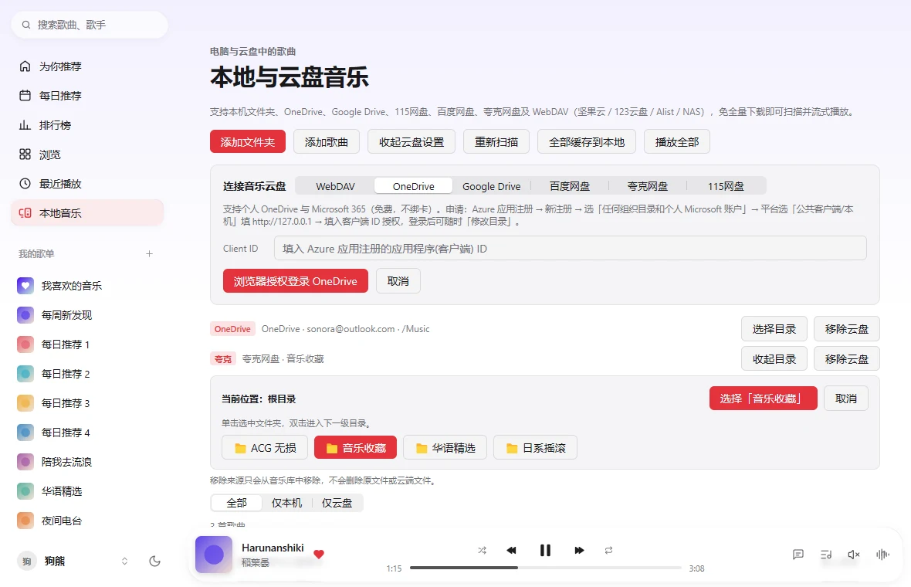
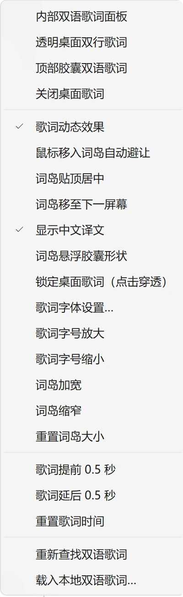
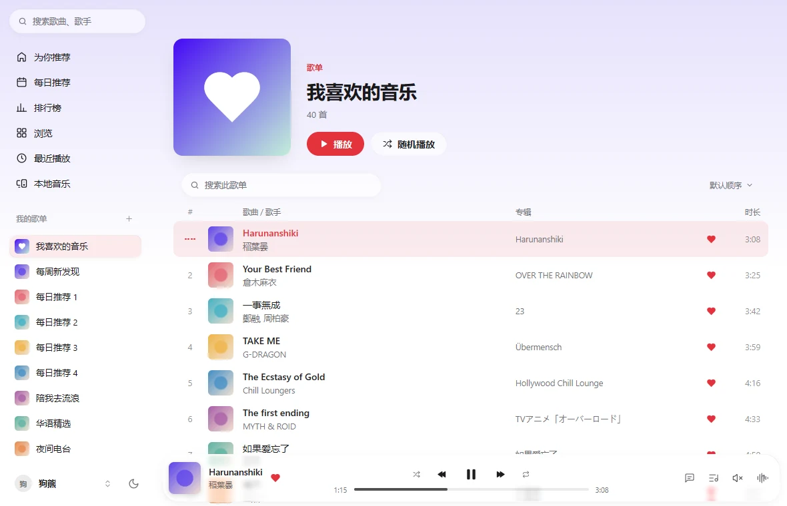

# Sonora

**[English](README.en.md)** | 简体中文

<p align="center">
  
</p>

<p align="center">
  基于 <b>Go + MyGo</b> 打造的原生 Spotify 桌面客户端与个人音乐云盘播放器（源于 <a href="https://github.com/margbug01/MySpotify">MySpotify</a>）<br>
  支持 <b>6 大网盘音乐云盘 · 双语逐字动效歌词 · 可拖动灵动岛 · 液态玻璃与流光背景 · Windows &amp; macOS 双端开箱即用</b>
</p>

<p align="center">
  <a href="https://github.com/hfx123456/Sonora/releases/latest"></a>
  
  
</p>

---

## 核心亮点一览

- **☁️ 个人音乐云盘（网易云式跨设备曲库）**：原生直连 **OneDrive / Microsoft 365、Google Drive、百度网盘、夸克网盘、115网盘、WebDAV**（内置坚果云 / 123云盘 / Alist 快捷预设），支持扫码登录、可视化选目录、边播边缓存与自动点亮 Spotify 歌单里的 `spotify:local:` 灰歌。
- **✨ 流光背景 & 液态玻璃**：Apple Music 风格 GPU 流体网格背景（Flow）与 iOS 风格液态玻璃（Liquid Glass）质感，支持强度滑块连续调节。
- **🎤 逐字双语动效歌词**：内嵌 Lyricify 歌词助手（网易云 + QQ 音乐 QRC 解密 + LRCLIB），原句与译文同步逐字弹跳/扫光，支持间奏保留上一句与呼吸倒计时点。
- **🏝️ 跨屏灵动岛 & 点击穿透桌面歌词**：自由拖动跨显示器、贴顶/悬浮胶囊自动切换、锁定点击穿透后移入/轻点即可浮出「解锁」按钮。
- **🎨 统一歌曲封面与吸顶胶囊搜索**：全站歌单、我喜欢的音乐、最近播放与本地/云盘库统一支持专辑封面（可在设置中一键开关），支持简繁匹配、空格多词筛选与完整队列播放。

---

## 1. 个人「音乐云盘」与本地音乐（跨设备同步）

把个人无损音频放进你自己的网盘，**换任何电脑登录 Sonora 都能直接流式播放，无需手动拷贝几 GB 歌曲**：

- **6 大云盘原生直连**：支持 **OneDrive / Microsoft 365**、**Google Drive**、**百度网盘**、**夸克网盘**、**115网盘** 与 **WebDAV**（坚果云 / 123云盘 / Alist / 群晖・飞牛 NAS）。
- **先登录，再可视化选目录**：夸克 / 115 支持内置窗口扫码一键登录；所有云盘登录后自动展开可视化文件夹浏览器（**单击选中、双击进入子目录**），选定音乐文件夹后才开始扫描，绝不误扫全盘。
- **极速扫盘 + 边播边缓存本地**：OneDrive 采用 `/delta` 扁平极速扫描，启动秒读本地索引；云盘歌曲点播时自动缓存到本机并解析高清内嵌专辑封面与标签，也支持点击 **「全部缓存到本地」** 批量离线化。
- **跨设备点亮 Spotify 歌单 & 一键上传**：云盘曲目自动匹配点亮 Spotify 歌单里原本灰掉的 `spotify:local:` 本地歌曲；本机歌曲右键可直接 **「上传到云盘」**；右键任意非歌曲音频可 **「从音乐库移除」**（不删原文件，并自动清理本地缓存）。
- **隐私安全**：所有网盘密码、Cookie 与 OAuth 刷新令牌均使用系统钥匙串（Windows DPAPI / macOS Keychain）加密保存在本机，不经过任何第三方服务器。

<table>
  <tr>
    <td width="50%"><br><b>6 大云盘连接 + 可视化选目录</b>：登录后单击选中文件夹、双击进入子目录。</td>
    <td width="50%"><br><b>自动补全封面与标签</b>：云盘歌曲缓存到本地后自动亮出高清封面与完整元数据。</td>
  </tr>
</table>

<details>
<summary><b>📖 云盘免费配置指南（全部 0 费用、不绑卡，点击展开）</b></summary>

- **夸克网盘 / 115网盘**：无需任何申请，点「添加云盘」→ 选对应网盘 → 点击 **「扫码登录」**，在弹出窗口扫码即可自动完成连接并挑选音乐文件夹。
- **WebDAV（坚果云 / 123云盘 / Alist / NAS）**：点「添加云盘 → WebDAV」，选用一键预设或填入 WebDAV 地址与账号密码即可。
- **OneDrive / Microsoft 365**（免费申请自己的 Client ID，1 分钟完成）：
  1. 打开 [Azure 应用注册](https://portal.azure.com/#view/Microsoft_AAD_RegisteredApps/ApplicationsListBlade) → 点 **「新注册」**（跳过订阅提示，无需绑卡）。
  2. 名称填 `Sonora`，受支持的账户类型选 **「任何组织目录中的账户和个人 Microsoft 账户」**（选仅个人账户同样自动兼容），重定向 URI 平台选 **「公共客户端/本机（移动和桌面）」** 并填 `http://127.0.0.1`。
  3. 复制生成的 **「应用程序(客户端) ID」** 填入 Sonora 即可浏览器一键授权。
- **Google Drive**：在 [Google Cloud Console](https://console.cloud.google.com/apis/dashboard) 启用 Google Drive API → 在「OAuth 同意屏幕」添加自己的 Gmail → 创建 **「桌面应用」** OAuth 凭据，将 Client ID 与 Secret 填入 Sonora 即可。
- **百度网盘**：在百度网盘开放平台免费创建应用（回调地址填 `http://127.0.0.1`），将 `AppKey` 与 `SecretKey` 填入 Sonora 即可。

</details>

---

## 2. 流光背景、液态玻璃与双语逐字歌词

- **流光背景（Flow）**：从当前专辑封面提取主色调，驱动 GPU 流体网格渐变随音乐柔和呼吸，切歌平滑过渡、暂停渐缓静止。
- **液态玻璃（Liquid Glass）**：iOS 风格磨砂折射质感覆盖底栏与悬浮控件，支持在设置中自由调节玻璃强度。
- **「律动」&「歌词」双语逐字动效**：中文译文随原句逐字/逐词弹性飞入、亮起封面主色微光并缓慢漂移；歌曲中段间奏自动保留上一句柔和淡暗的歌词并配合底部呼吸倒计时点。

<table>
  <tr>
    <td width="50%"><br><b>「律动」双语逐字舞台</b>：原词与中文译文同步逐字弹性亮起，指针移开自动隐藏播控栏。</td>
    <td width="50%"><br><b>「歌词」流光 + 液态玻璃</b>：逐字连续扫光与轻抬动效，原词与译文同步推进。</td>
  </tr>
</table>

---

## 3. 跨屏灵动岛 & 透明桌面歌词

- **自由拖动 & 跨显示器**：顶部灵动岛可自由拖动至任意位置或另一块显示器——拖离屏幕顶部自动切换为**圆角悬浮胶囊**，拖回任意屏幕顶部边缘自动**贴顶吸附**；多屏环境支持右键「词岛移至下一屏幕」。
- **锁定穿透 + 悬停一键解锁**：开启点击穿透锁定后不遮挡下方操作、无多余黑框；鼠标移入或轻点歌词区域即自动浮出可点击的 **「解锁」** 小胶囊。
- **多源双语词库开箱即用**：内置 Lyricify 歌词助手与 .NET 运行时，聚合 **网易云音乐、QQ 音乐（本地解密 QRC）、LRCLIB**，支持罗马音/跨文字体系别名匹配、手动选源与 `±0.5s` 轴偏移微调。

<table>
  <tr>
    <td width="50%"><br><b>悬浮灵动岛</b>：拖离顶部或拖至副屏后自动切换为独立圆角胶囊。</td>
    <td width="50%"><br><b>锁定态一键解锁</b>：保持点击穿透，移入或点击自动浮出「解锁」按钮。</td>
  </tr>
  <tr>
    <td width="50%"><br><b>贴顶灵动岛</b>：紧贴屏幕顶部边缘，集成动态音波柱与双语字幕。</td>
    <td width="50%"><br><b>透明桌面歌词</b>：清晰双语描边字幕，支持单独设置中文字体。</td>
  </tr>
  <tr>
    <td width="50%"><br><b>侧边双语词面板</b>：独立字体缩放、译文开关与时间轴微调。</td>
    <td width="50%"><br><b>多源检索与切换</b>：一键重搜网易云 / QQ 音乐 / LRCLIB 词源。</td>
  </tr>
</table>

---

## 4. 统一歌曲封面开关 & 吸顶胶囊搜索

- **全站列表统一专辑封面**：歌单、我喜欢的音乐、最近播放、每日推荐、艺人热门与本地/云盘音乐统一显示圆角专辑封面，可在 **「设置 → 外观 → 列表显示歌曲封面」** 一键开关。
- **吸顶胶囊搜索 & 简繁多词筛选**：滚动歌单或本地库时搜索框自动吸顶悬浮，支持 `Ctrl+F` 快捷聚焦、简繁互搜、空格多关键词组合，筛选后双击播放仍保留完整队列。

<table>
  <tr>
    <td width="50%"><br><b>统一专辑封面（可开关）</b>：歌单与我喜欢的音乐默认展示每首歌的专辑缩略图。</td>
    <td width="50%"><br><b>吸顶胶囊搜索</b>：简繁匹配、空格多词筛选与一致的歌单排序。</td>
  </tr>
</table>

---

## 下载与开始使用

1. 前往 **[Sonora Releases](https://github.com/hfx123456/Sonora/releases/latest)** 下载最新版本：
   - **Windows**：推荐下载一键安装包 `sonora-setup-1.0.1-amd64.exe`（自动创建快捷方式并按需安装 WebView2）；或下载便携版 `Sonora-1.0.1-windows-amd64.zip` 解压即用。
   - **macOS**：下载通用镜像 `sonora-1.0.1-universal.dmg`（同时支持 Apple Silicon 与 Intel），拖入「应用程序」即可；因未进行 Apple 公证，首次打开请右键「打开」或在「系统设置 → 隐私与安全性」中允许运行。
2. Windows 与 macOS 安装包均已内嵌 Lyricify 歌词助手与 .NET 运行时，**无需额外安装任何依赖**。

## 数据隔离与自动更新

- **独立双开不冲突**：使用独立单实例锁、应用标识（`dev.hfx123456.sonora`）与数据目录（`%APPDATA%\Sonora` / `%LOCALAPPDATA%\Sonora`），可与原版 MySpotify 并行运行；首次启动自动迁移旧配置且保留原目录不动。
- **独立更新源**：支持在「设置 → 关于」一键检查并更新至最新 Release。

## 上游致谢与声明

Spotify 首页浏览、搜索、歌单、专辑、艺人、喜欢与收藏、在线播放、MV、播客、系统媒体键、全局快捷键、托盘及基础框架来自上游 [margbug01/MySpotify](https://github.com/margbug01/MySpotify)，完整保留 **AGPL-3.0** 开源协议。

Sonora 为非官方个人开源项目，与 Spotify 无关；在线功能依赖网页播放器内部接口，请仅使用自己的账号。

## 从源码构建

```powershell
$env:CGO_ENABLED = '0'
go test ./internal/...
go build -trimpath -ldflags='-H windowsgui -s -w' -o Sonora.exe .
```

更多开发细节见 [DEVELOPMENT.md](DEVELOPMENT.md)、[FUSION.md](FUSION.md) 与 [CHANGELOG.md](CHANGELOG.md)。
