# Sonora

**[English](README.en.md)** | 简体中文

<p align="center">
  
</p>

<p align="center">
  基于 <b>Go + MyGo</b> 打造的原生多音源桌面音乐播放器（源于 <a href="https://github.com/margbug01/MySpotify">MySpotify</a>）<br>
  支持 <b>Spotify + 网易云歌单直连 + 6 大个人音乐云盘 + 四源混合歌单 · 跨音源智能去重混播 · 双语逐字动效歌词 · 可拖动灵动岛 · Apple Music 风格迷你播放器 · 6 种动效进度条 · Windows &amp; macOS 双端开箱即用</b>
</p>

<p align="center">
  <a href="https://github.com/hfx123456/Sonora/releases/latest"></a>
  
  
  <a href="https://awesomemygo.dev/apps/sonora"></a>
</p>

<p align="center">
  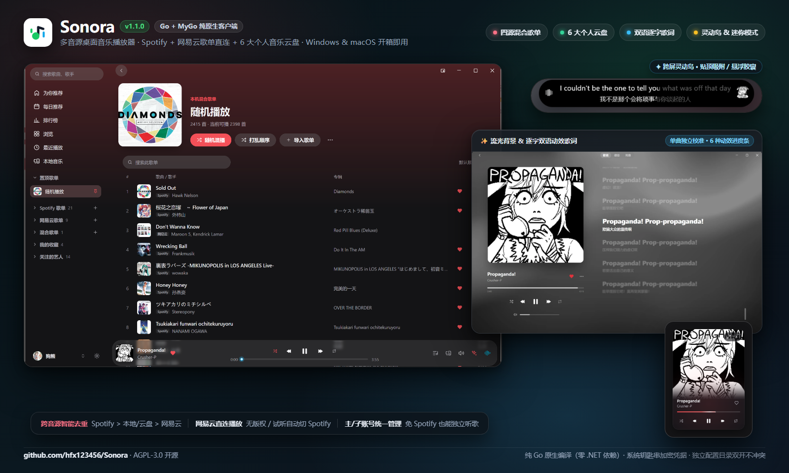
</p>

---

## 核心亮点一览

- **🎶 网易云歌单直接接入 & 无需 Spotify 也能听歌**：侧栏独立 **「网易云歌单」** 分组，支持在 **「设置 → 账号」** 扫码登录网易云（统一头像卡片，`Spotify 主账号` + `网易云子账号`）自动同步全部歌单，或免登录粘贴公开歌单链接/ID 持久保存；播放时默认直连网易云接口并按歌曲 ID 精准拉取逐行/双语歌词，遇到无版权或仅限 30 秒试听的曲目自动无缝切换至本地/云盘或 Spotify 完整版。
- **🔀 四源混合歌单 & 跨音源智能去重**：将 **Spotify、网易云、本机文件与云盘音乐** 混排进同一张本机混合歌单，支持整单导入、一键打乱与直接随机混播；跨音源自动识别同一首歌（繁简归一化 + 标题清理 + 多歌手排序），随机播放与导入自动跳过重复项并按 **`Spotify > 本地/云盘 > 网易云`** 保留最高优先级音源；底栏悬停封面「制作人员」浮窗实时展示当前播放 **来源**。
- **☁️ 个人音乐云盘（网易云式跨设备曲库）**：原生直连 **OneDrive / Microsoft 365、Google Drive、百度网盘、夸克网盘、115网盘、WebDAV**（内置坚果云 / 123云盘 / Alist 快捷预设），支持扫码登录、可视化选目录、边播边缓存与自动点亮 Spotify 歌单里的 `spotify:local:` 灰歌。
- **✨ 流光背景 & 液态玻璃**：Apple Music 风格 GPU 流体网格背景（Flow）与 iOS 风格液态玻璃（Liquid Glass）质感，支持强度滑块连续调节。
- **🎤 逐字双语动效歌词 & 单曲独立校准**：纯 Go 原生多源歌词引擎（网易云 + QQ 音乐 QRC 解密 + LRCLIB），原句与译文同步逐字弹跳/扫光，支持间奏保留上一句、呼吸倒计时点，以及**按「歌曲 + 歌词源」独立记忆的 `±0.2s` 时间轴校准**（全端同步生效，不串歌）。
- **🏝️ 跨屏灵动岛 & 点击穿透桌面歌词**：自由拖动跨显示器、贴顶/悬浮胶囊自动切换、锁定点击穿透后移入/轻点即可浮出「解锁」按钮。
- **🎛️ Apple Music 风格迷你播放器（双形态 + 同步深浅外观）**：支持 **紧凑长条**（同心 `16px` 圆角 + 定向柔光内描边，平时极简显示歌名与动效进度条，悬停原地切换播控）与 **渐变融底封面卡片**（满幅圆角封面平滑羽化融进控栏、零硬拼缝、全区可拖动且含红心喜欢与播控），窗口右上角原生风格按钮一键从大窗直切迷你模式、小窗 `⤢` 一键返回主窗口，自动同步应用浅色/黑夜外观。
- **🌈 6 种全局同步进度条特效**：内置 **极光扫光（默认）、律动声波、呼吸光珠、星尘光点、彗星烟雾、经典极简** 6 种高颜值进度条样式，点击底栏 ✨「进度条样式」按钮、右键进度条/小窗或在设置中一键切换，主界面底栏、播放页与迷你播放器实时同步，黑白封面也能保持通透鲜亮。
- **🎵 无边框音符飘落开机动画**：冷启动时在透明桌面上直接飘落矢量音符，无白底成形 Sonora 音符后丝滑渐显主页；支持设置内一键开关并自动遵循系统「减少动态效果」。
- **🎨 统一歌曲封面与吸顶胶囊搜索**：全站歌单、我喜欢的音乐、最近播放与本地/云盘库统一支持专辑封面（可在设置中一键开关），支持简繁匹配、空格多词筛选、点喜欢/加歌单秒级原地更新与排序一致播放。

---

## 1. 个人「音乐云盘」与本地音乐（跨设备同步）

把个人无损音频放进你自己的网盘，**换任何电脑登录 Sonora 都能直接流式播放，无需手动拷贝几 GB 歌曲**：

- **6 大云盘原生直连**：支持 **OneDrive / Microsoft 365**、**Google Drive**、**百度网盘**、**夸克网盘**、**115网盘** 与 **WebDAV**（坚果云 / 123云盘 / Alist / 群晖・飞牛 NAS）。
- **先登录，再可视化选目录**：夸克 / 115 支持内置窗口扫码一键登录；所有云盘登录后自动展开可视化文件夹浏览器（**单击选中、双击进入子目录**），选定音乐文件夹后才开始扫描，绝不误扫全盘。
- **极速扫盘 + 边播边缓存本地**：OneDrive 采用 `/delta` 扁平极速扫描，启动秒读本地索引；云盘歌曲点播时自动缓存到本机并解析高清内嵌专辑封面与标签，也支持点击 **「全部缓存到本地」** 批量离线化。
- **跨设备点亮 Spotify 歌单 & 一键上传**：云盘曲目自动匹配点亮 Spotify 歌单里原本灰掉的 `spotify:local:` 本地歌曲；本机歌曲右键可直接 **「上传到云盘」**；右键任意非歌曲音频可 **「从音乐库移除」**（不删原文件，并自动清理本地缓存）。
- **隐私安全**：所有网盘密码、Cookie 与 OAuth 刷新令牌均使用系统钥匙串（Windows DPAPI / macOS Keychain）加密保存在本机，不经过任何第三方服务器。

<table>
  <tr>
    <td width="50%"><br><b>6 大云盘连接 + 可视化选目录</b>：登录后单击选中文件夹、双击进入子目录。</td>
    <td width="50%">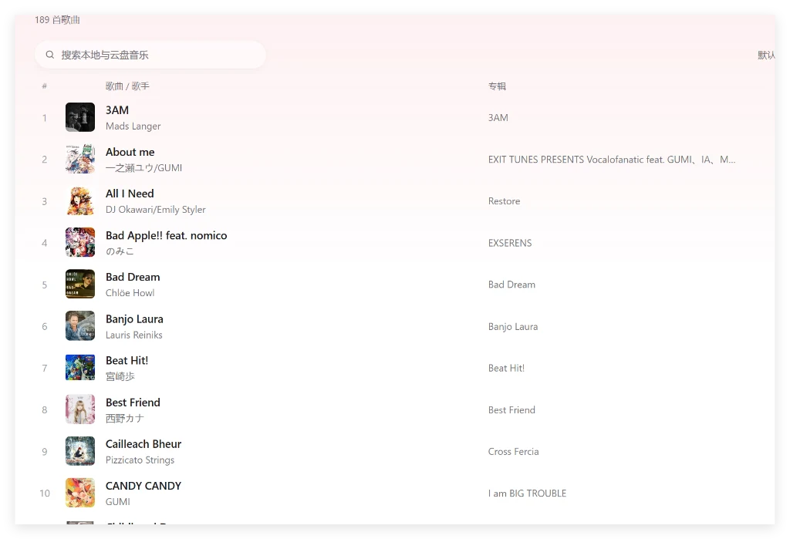<br><b>自动补全封面与标签</b>：云盘歌曲缓存到本地后自动亮出高清封面与完整元数据。</td>
  </tr>
</table>

<details>
<summary><b>📖 云盘免费配置指南（全部 0 费用、不绑卡，点击展开）</b></summary>

- **夸克网盘 / 115网盘**：无需任何申请，点「添加云盘」→ 选对应网盘 → 点击 **「扫码登录」**，在弹出窗口扫码即可自动完成连接并挑选音乐文件夹。
- **WebDAV（坚果云 / 123云盘 / Alist / NAS）**：点「添加云盘 → WebDAV」，选用一键预设或填入 WebDAV 地址与账号密码即可。
- **OneDrive / Microsoft 365**（免费申请自己的 Client ID，1 分钟完成）：
  1. 打开 [Azure 应用注册](https://portal.azure.com/#view/Microsoft_AAD_RegisteredApps/ApplicationsListBlade) → 点 **「新注册」**（跳过订阅提示，无需绑卡）。
  2. 名称填 `Sonora`，受支持的账户类型选 **「任何组织目录中的账户和个人 Microsoft 账户」**（选仅个人账户同样自动兼容），重定向 URI 平台选 **「公共客户端/本机（移动和桌面）」** 并填 `http://127.0.0.1`。
  3. 复制生成的 **「应用程序(客户端) ID」** 填入 Sonora 即可浏览器一键授权。
- **Google Drive**：在 [Google Cloud Console](https://console.cloud.google.com/apis/dashboard) 启用 Google Drive API → 在「OAuth 同意屏幕」添加自己的 Gmail → 创建 **「桌面应用」** OAuth 凭据，将 Client ID 与 Secret 填入 Sonora 即可。
- **百度网盘**：在百度网盘开放平台免费创建应用（回调地址填 `http://127.0.0.1`），将 `AppKey` 与 `SecretKey` 填入 Sonora 即可。

</details>

---

## 2. 流光背景、液态玻璃与双语逐字歌词

- **流光背景（Flow）**：从当前专辑封面提取主色调，驱动 GPU 流体网格渐变随音乐柔和呼吸，切歌平滑过渡、暂停渐缓静止。
- **液态玻璃（Liquid Glass）**：iOS 风格磨砂折射质感覆盖底栏与悬浮控件，支持在设置中自由调节玻璃强度。
- **「律动」&「歌词」双语逐字动效**：中文译文随原句逐字/逐词弹性飞入、亮起封面主色微光并缓慢漂移；歌曲中段间奏自动保留上一句柔和淡暗的歌词并配合底部呼吸倒计时点。

<table>
  <tr>
    <td width="50%">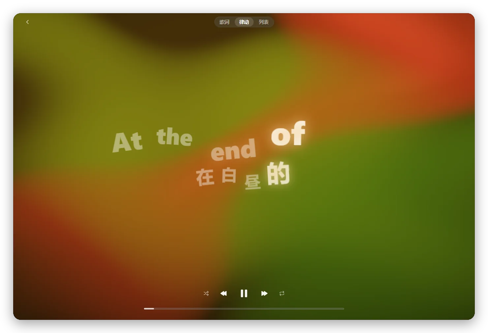<br><b>「律动」双语逐字舞台</b>：原词与中文译文同步逐字弹性亮起，指针移开自动隐藏播控栏。</td>
    <td width="50%">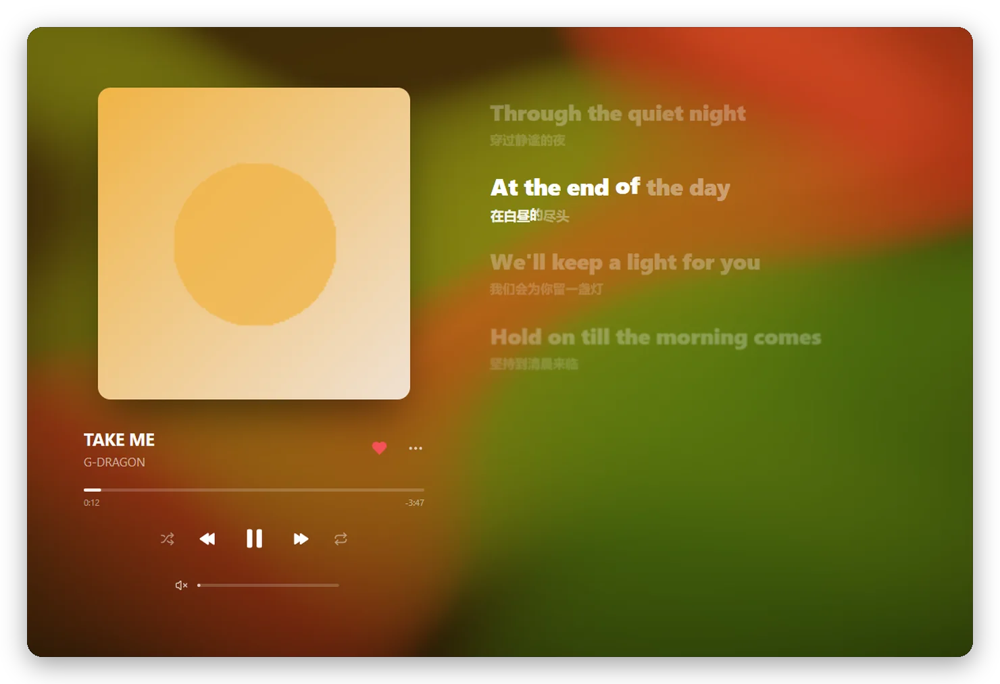<br><b>「歌词」流光 + 液态玻璃</b>：逐字连续扫光与轻抬动效，原词与译文同步推进。</td>
  </tr>
</table>

---

## 3. 跨屏灵动岛 & 透明桌面歌词

- **自由拖动 & 跨显示器**：顶部灵动岛可自由拖动至任意位置或另一块显示器——拖离屏幕顶部自动切换为**圆角悬浮胶囊**，拖回任意屏幕顶部边缘自动**贴顶吸附**；多屏环境支持右键「词岛移至下一屏幕」。
- **锁定穿透 + 悬停一键解锁**：开启点击穿透锁定后不遮挡下方操作、无多余黑框；鼠标移入或轻点歌词区域即自动浮出可点击的 **「解锁」** 小胶囊。
- **多源双语词库开箱即用**：内置纯 Go 多源歌词引擎（零 `.NET` 依赖），聚合 **网易云音乐、QQ 音乐（本地解密 QRC）、LRCLIB**，原生解析 YRC / QRC / TTML / LYS / LYL / LRC，支持罗马音/跨文字体系别名匹配、手动选源与 `±0.5s` 轴偏移微调。

<table>
  <tr>
    <td width="50%">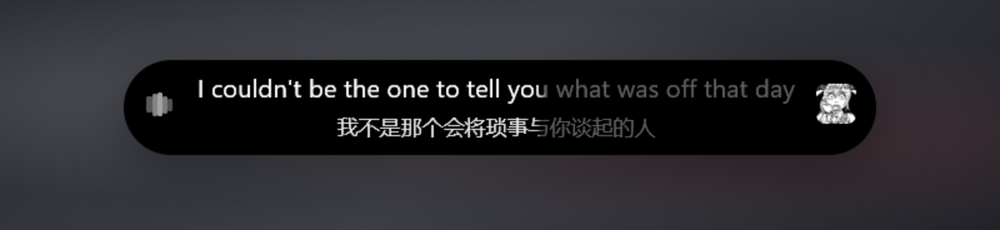<br><b>悬浮灵动岛</b>：拖离顶部或拖至副屏后自动切换为独立圆角胶囊。</td>
    <td width="50%"><br><b>锁定态一键解锁</b>：保持点击穿透，移入或点击自动浮出「解锁」按钮。</td>
  </tr>
  <tr>
    <td width="50%">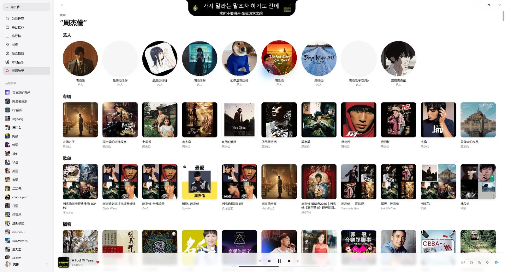<br><b>贴顶灵动岛</b>：紧贴屏幕顶部边缘，集成动态音波柱与双语字幕。</td>
    <td width="50%">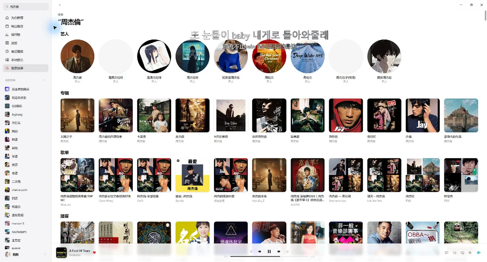<br><b>透明桌面歌词</b>：清晰双语描边字幕，支持单独设置中文字体。</td>
  </tr>
  <tr>
    <td width="50%">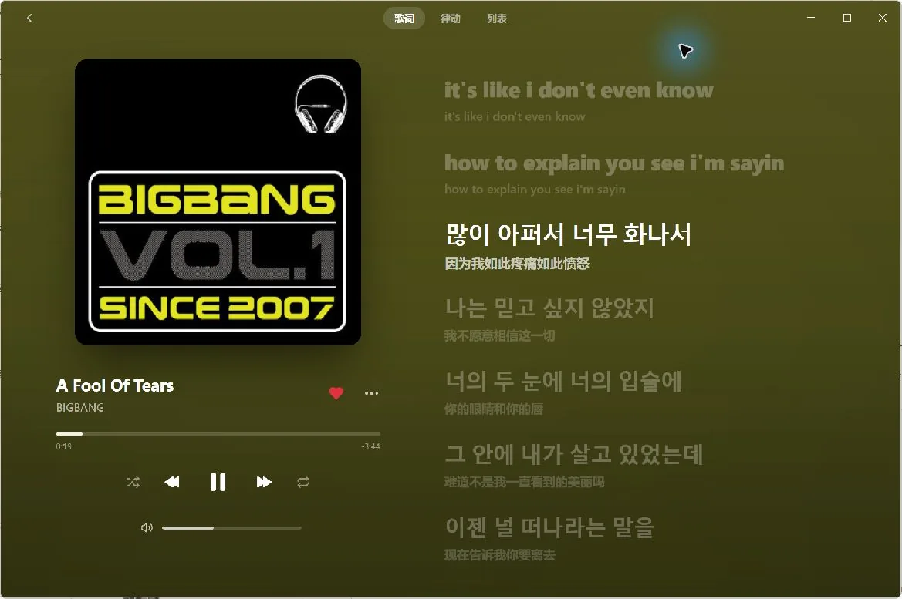<br><b>侧边双语词面板</b>：独立字体缩放、译文开关与时间轴微调。</td>
    <td width="50%"><br><b>多源检索与切换</b>：一键重搜网易云 / QQ 音乐 / LRCLIB 词源。</td>
  </tr>
</table>

---

## 4. 统一歌曲封面开关 & 吸顶胶囊搜索

- **全站列表统一专辑封面**：歌单、我喜欢的音乐、最近播放、每日推荐、艺人热门与本地/云盘音乐统一显示圆角专辑封面，可在 **「设置 → 外观 → 列表显示歌曲封面」** 一键开关。
- **吸顶胶囊搜索 & 简繁多词筛选**：滚动歌单或本地库时搜索框自动吸顶悬浮，支持 `Ctrl+F` 快捷聚焦、简繁互搜、空格多关键词组合，筛选后双击播放仍保留完整队列。

<table>
  <tr>
    <td width="50%">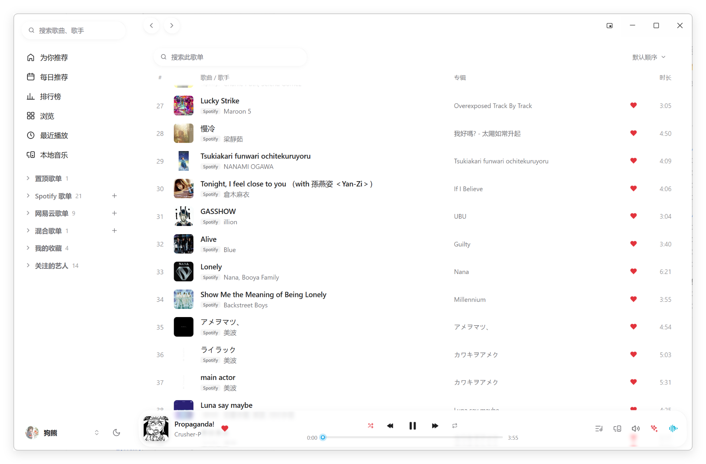<br><b>统一专辑封面（可开关）</b>：歌单与我喜欢的音乐默认展示每首歌的专辑缩略图。</td>
    <td width="50%">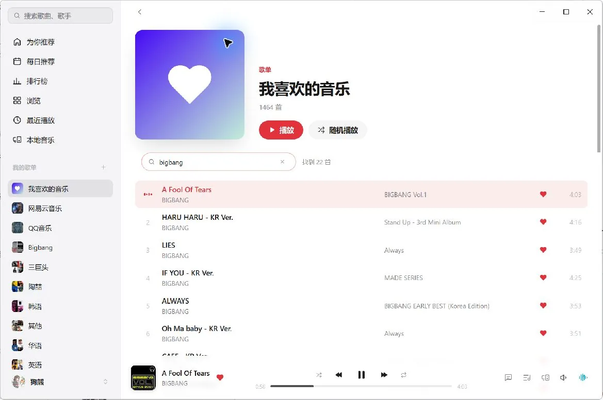<br><b>吸顶胶囊搜索</b>：简繁匹配、空格多词筛选与一致的歌单排序。</td>
  </tr>
</table>

---

## 5. Apple Music 风格迷你播放器、6 种动效进度条 & 开机动画

- **主窗口 ↔ 迷你模式一键直切**：点击主窗口与全屏播放页右上角（Windows 原生对齐最小化/最大化/关闭按钮左侧）的 **切换迷你模式** 图标，直接将大窗口收起并切入悬浮迷你小窗；点击小窗右上角 `⤢` 或封面即可无缝返回主窗口。支持 **紧凑长条**（`360 × 56`，严格同心 `16px` 圆角与内缩柔光描边，平时居中极简显示歌名、歌手与动效进度条，悬停原地平滑切出 5 键播控）与 **渐变融底封面卡片**（`232 × 324` 统一 `18px` 圆角底板，满幅封面底部通过 Oklab 羽化平滑融进控栏、整片封面均可直接拖动，下方集成红心喜欢、可拖动进度条与播控键），自动同步主窗口浅色 / 黑夜外观并记忆拖动位置。
- **6 种高颜值进度条特效（全局同步可随时切换）**：点击主界面底栏音量旁的 ✨ **「进度条样式」** 按钮、右键进度条/迷你小窗，或在 **「设置 → 外观 → 进度条样式」** 中自由切换，**主界面底栏、播放页、律动舞台与迷你播放器**实时同步生效（自动适配黑白/暗色封面，绝不发灰脏字）：
  - **极光扫光（默认）**：柔和双色渐变轨道 + 轻盈白光流光缓缓扫过；
  - **律动声波**：微缩音轨波形柱，当前进度头附近细柱随音乐实时律动起伏；
  - **呼吸光珠**：双色细轨 + 末端晶莹光珠随节拍轻柔呼吸并泛出贴边微晕；
  - **星尘光点**：进度头轻盈散出清透 2px 星尘光点并闪烁消散；
  - 同时保留 **彗星烟雾** 与 **经典极简** 两种模式。
- **无边框音符飘落开机动画**：冷启动不弹出突兀大白窗，直接在透明桌面上飘落矢量音符，无白底成形 Sonora 音符后平滑渐显主窗口；可在 **「设置 → 外观 → 开机动画」** 一键开关，且自动遵循系统「减少动态效果」偏好。

<table>
  <tr>
    <td width="58%" align="center">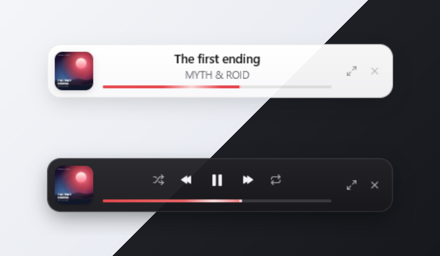<br><b>Apple Music 紧凑长条（浅色 / 黑夜模式）</b>：平时极简、悬停原地切播控，自动同步主应用深浅外观。</td>
    <td width="42%" align="center">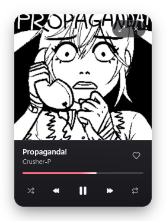<br><b>渐变融底封面卡片（黑夜模式）</b>：满幅圆角封面自然羽化融进控栏，全区可直接拖动，集成红心喜欢与动效进度条。</td>
  </tr>
  <tr>
    <td colspan="2" align="center">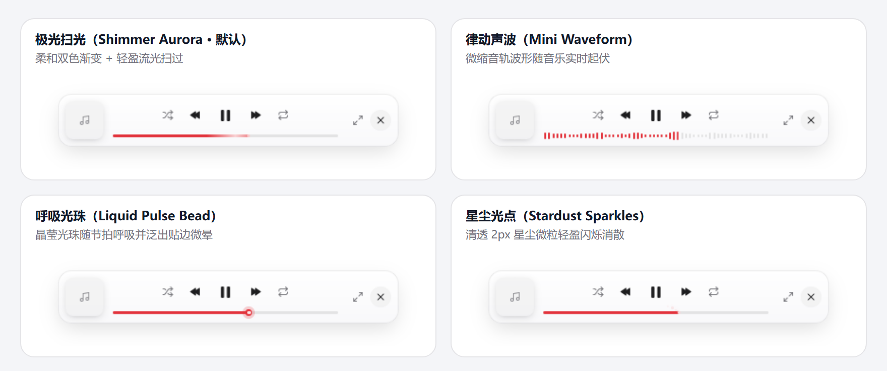<br><b>4 套全新全局同步进度条特效（Go 原生实机渲染）</b>：极光扫光 · 律动声波 · 呼吸光珠 · 星尘光点，底栏 ✨ 按钮一键实时切换。</td>
  </tr>
</table>

---

## 6. 网易云歌单直接接入、四源混合歌单与智能去重

让 Spotify、网易云、本机无损与网盘曲库真正融为一体，**哪怕没有 Spotify 账号，也能直接用网易云 + 本地/云盘畅听**：

- **独立「网易云歌单」分组与双账号体系**：
  - 侧栏歌单清晰划分为 **「置顶歌单」→「Spotify 歌单」→「网易云歌单」→「混合歌单」→「我的收藏」**，均支持折叠、双列封面网格与统一置顶。
  - 在 **「设置 → 账号」** 卡片中统一管理 **Spotify（主账号）** 与 **网易云音乐（子账号）**，显示圆形头像、昵称、已同步歌单数与一键刷新/退出；凭证使用系统钥匙串加密保存。
  - 也可免登录点击「网易云歌单」右侧 `+`，直接粘贴网易云分享文案、`163cn.tv` 短链或纯数字歌单 ID 持久化添加到侧栏（自动补全超过千首的完整曲目）。
- **网易云默认直连 + 不可播自动回退**：
  - 播放网易云曲目时默认走网易云官方播放接口（支持已登录 Cookie，最高 320kbps），并按歌曲 ID 精准拉取逐行歌词与中文译文。
  - 遇到网易云无版权、下架或仅限 30 秒试听的曲目时，播放引擎自动无缝接力到本机/云盘曲库或 Spotify 完整版，并缓存回退映射加速后续重播；底栏悬停封面弹出「制作人员」浮窗时，底部 **「来源」** 行会实时标明实际播放来源（如 `Spotify`、`网易云`、`网易云（已切换 Spotify）`、`本机` 等）。
- **四源混合歌单与跨音源优先级去重**：
  - 任意 Spotify、网易云、本机或云盘歌单均可一键整单导入混合歌单，支持 **一键打乱顺序** 与 **主按钮直接随机混播**。
  - 导入与随机播放均内置跨音源智能去重（繁简体归一化、标题清理与多歌手排序），同一首歌在不同来源同时存在时自动跳过重复项，并严格遵循 **`Spotify > 本地/云盘 > 网易云`** 优先级（导入更高优先级音源时自动原位升级）。
- **单曲独立歌词时间校准**：
  - 歌词时间偏移按 **「歌曲 + 歌词源」** 独立记忆并持久化，桌面歌词、顶部灵动岛、侧边双语面板、Now Playing 与律动舞台完全同步，提供 `±0.2s` 精细微调与点击归零。

<table>
  <tr>
    <td width="50%">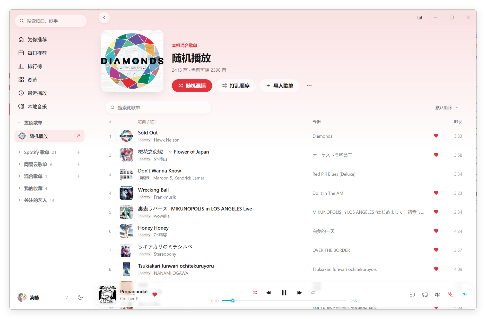<br><b>四源混合歌单 &amp; 侧栏多音源分组</b>：Spotify、网易云、本机与云盘同单混排，一键随机混播与智能去重。</td>
    <td width="50%">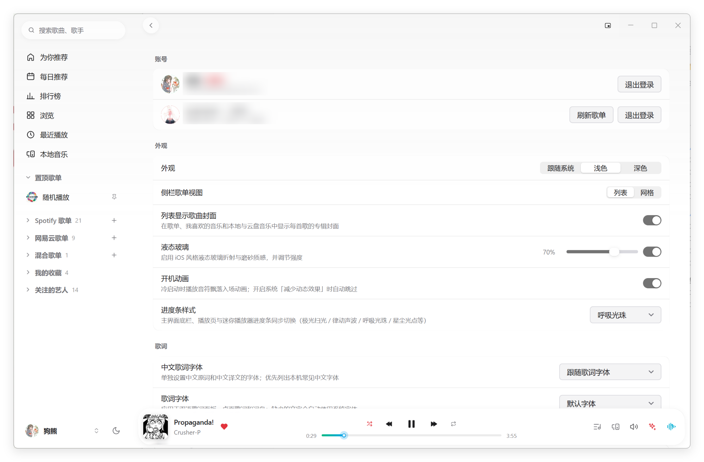<br><b>双账号统一管理（设置 › 账号）</b>：Spotify 主账号与网易云子账号统一头像样式，一键刷新歌单。</td>
  </tr>
  <tr>
    <td colspan="2" align="center">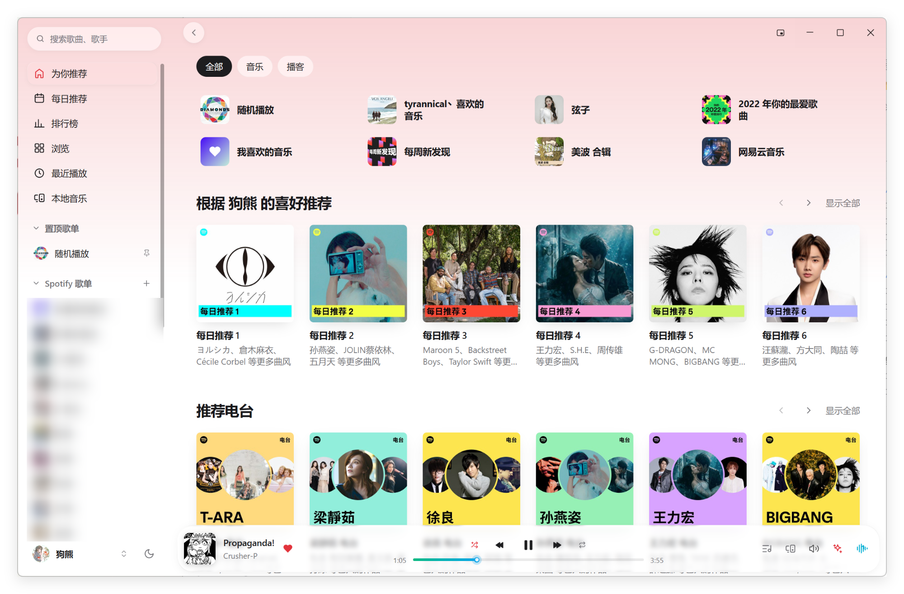<br><b>Sonora v1.1.0 主页总览</b>：置顶歌单、Spotify / 网易云 / 混合歌单清晰分层，配合液态玻璃与动效进度条。</td>
  </tr>
</table>

---

## 下载与开始使用

1. 前往 **[Sonora Releases](https://github.com/hfx123456/Sonora/releases/latest)** 下载最新版本：
   - **Windows**：推荐下载一键安装包 `sonora-setup-1.1.0-amd64.exe`（自动创建快捷方式并按需安装 WebView2）；或下载便携版 `Sonora-1.1.0-windows-amd64.zip` 解压即用。
   - **macOS**：下载通用镜像 `sonora-1.1.0.dmg`（同时支持 Apple Silicon 与 Intel），拖入「应用程序」即可；因未进行 Apple 公证，首次打开请右键「打开」或在「系统设置 → 隐私与安全性」中允许运行。
2. 全程纯 Go 原生编译（仅约 20 MB），**无需额外安装 `.NET` 或任何第三方运行库**。

## 数据隔离与自动更新

- **独立双开不冲突**：使用独立单实例锁、应用标识（`dev.hfx123456.sonora`）与数据目录（`%APPDATA%\Sonora` / `%LOCALAPPDATA%\Sonora`），可与原版 MySpotify 并行运行；首次启动自动迁移旧配置且保留原目录不动。
- **独立更新源**：支持在「设置 → 关于」一键检查并更新至最新 Release。

## 致谢与声明

- **[margbug01/MySpotify](https://github.com/margbug01/MySpotify)**（**AGPL-3.0**）：Spotify 首页浏览、搜索、歌单、专辑、艺人、喜欢与收藏、在线播放、MV、播客、系统媒体键、全局快捷键、托盘及基础客户端架构来自上游 MySpotify，完整保留 **AGPL-3.0** 开源协议。
- **[egoist/mygo](https://github.com/egoist/mygo)**（**MIT**）：原生跨平台桌面界面、动画弹簧、液态玻璃材质与 GPU 着色器管线均基于 MyGo 构建。
- **[WXRIW / Lyricify](https://github.com/WXRIW/Lyricify-App)**：
  - **[Lyricify Lyrics Helper](https://github.com/WXRIW/Lyricify-Lyrics-Helper)**（**Apache-2.0**）：提供网易云音乐、QQ 音乐（QRC 解密）与 LRCLIB 多源双语歌词检索与解析。
  - **[Lyricify Backgrounds](https://github.com/WXRIW/Lyricify-Backgrounds)**（**Apache-2.0**）：动态背景着色器效果参考自 iOS Classic 背景实现。
  - **Dynamic Lyrics Island（动态歌词岛）概念**（**CC BY-SA 4.0**）：顶部词岛与桌面歌词视觉交互参考自 Lyricify 官方设计。
- 更多依赖与完整第三方许可原文见 [THIRD-PARTY-NOTICES.md](THIRD-PARTY-NOTICES.md) 与 `licenses/` 目录。

Sonora 为非官方个人开源项目，与 Spotify 无关；在线功能依赖网页播放器内部接口，请仅使用自己的账号。

## 从源码构建

```powershell
$env:CGO_ENABLED = '0'
go test ./internal/...
go build -trimpath -ldflags='-H windowsgui -s -w' -o Sonora.exe .
```

更多开发细节见 [DEVELOPMENT.md](DEVELOPMENT.md)、[FUSION.md](FUSION.md) 与 [CHANGELOG.md](CHANGELOG.md)。
